# Angel Dineo Masonganye
### ICT Student · Applications Development · CPUT

📍 Woodstock, Cape Town, South Africa
📱 068 185 3204
📧 angeldineo773@gmail.com
💻 [github.com/Angel7Neo](https://github.com/Angel7Neo)
🔗 [linkedin.com/in/angel-dineo-masonganye](https://www.linkedin.com/in/angeldineo-masonganye-8274b5330)

## 🎯 Objective

Third-year ICT student at CPUT seeking a WIL placement in Cape Town. I bring real client delivery experience alongside strong full-stack fundamentals — ready to contribute from day one.

## 🎓 Education

**Cape Peninsula University of Technology**
Diploma in ICT (Applications Development)
*2024 – Present | Expected Graduation: 2027*

## 🛠️ Technical Skills

| Area | Skills |
|------|--------|
| **Frontend** | HTML5, CSS3, JavaScript ES6+, React.js, Responsive Design, UI/UX |
| **Backend** | Java 21, Spring Boot, Spring Data JPA, Node.js, Express.js, REST APIs |
| **Databases** | MySQL, Firebase, MongoDB |
| **Tools** | Git & GitHub, VS Code, Postman, Figma, Stripe API |
| **Soft Skills** | Problem-Solving, Communication, Agile/Scrum, Team Collaboration |

# Angel Dineo Masonganye
### ICT Student · Applications Development · CPUT

📍 Woodstock, Cape Town, South Africa
📱 068 185 3204
📧 angeldineo773@gmail.com
💻 [github.com/Angel7Neo](https://github.com/Angel7Neo)
🔗 [linkedin.com/in/angel-dineo-masonganye](https://www.linkedin.com/in/angeldineo-masonganye-8274b5330)

## 🎯 Objective

Third-year ICT student at CPUT seeking a WIL placement in Cape Town. I bring real client delivery experience alongside strong full-stack fundamentals — ready to contribute from day one.

## 🎓 Education

**Cape Peninsula University of Technology**
Diploma in ICT (Applications Development)
*2024 – Present | Expected Graduation: 2027*

## 🛠️ Technical Skills

| Area | Skills |
|------|--------|
| **Frontend** | HTML5, CSS3, JavaScript ES6+, React.js, Responsive Design, UI/UX |
| **Backend** | Java 21, Spring Boot, Spring Data JPA, Node.js, Express.js, REST APIs |
| **Databases** | MySQL, Firebase, MongoDB |
| **Tools** | Git & GitHub, VS Code, Postman, Figma, Stripe API |
| **Soft Skills** | Problem-Solving, Communication, Agile/Scrum, Team Collaboration |

## 🏆 Highlights

- 🏆 Real client delivery while still a student
- 🚀 Self-taught Stripe, Go & Firebase outside curriculum
- 💻 4 full-stack projects across 4+ languages

## 🚀 Projects

### 🛍️ GPAURA — Luxury E-Commerce Platform *(Client Project)*
- Built a full e-commerce platform for a luxury fashion client using React and Node.js
- Integrated Stripe payment gateway for secure card payments and transaction management
- Developed a fully functional admin dashboard for product, order, and user management
- Executed a complete theme overhaul — custom branding, typography, and responsive layouts

**Stack:** React, Node.js, Stripe API, CSS3

### 💸 Expense Tracker — Full-Stack Web App *(Personal Project)*
- Built secure user authentication and full CRUD expense management
- Designed interactive dashboard with pie and bar charts for spending insights
- Implemented filtering, monthly summaries, and data visualisation across all devices

**Stack:** React, Java Spring Boot, Spring Data JPA, MySQL

### 🏥 CampusMate — Health Appointment System *(School Project)*
- Web system enabling students to book campus health appointments online, cutting clinic queues
- Built clean UI with HTML/CSS/JS and a Go-powered backend with secure REST endpoints

**Stack:** JavaScript, Go, HTML/CSS

## 📋 References

**Samuel Makgato**
Pastor
📧 Lesole.Makgato@gmail.com
📞 073 332 9423

**Michele Malukeke**
Teacher
📧 kutloanomaluks@gmail.com
📞 068 573 1023

## 🎤 Mock Interview Video

<video width="720" controls>
  <source src="./mock-interview.mp4" type="video/mp4">
  Your browser does not support the video tag.
</video>

## 📝 Reflection 1: Coding My CV in Markdown

**Situation:**
As part of my Project Presentation 3 module, I was required to design my CV using Markdown language and host it on GitHub. Before this task, I had never written a CV in Markdown and was unfamiliar with how formatting worked in a plain-text environment.

**Task:**
My goal was to recreate my professional CV entirely in Markdown, making it readable, well-structured, and visually organised without using any word processors or design tools.

**Action:**
I studied the basics of Markdown syntax, including how to use headings, tables, bullet points, bold text, and links. I then structured my CV section by section starting with my contact details, objective, education, skills table, projects, and references. I used a table to present my technical skills clearly and added emojis to make sections visually distinct.

**Result:**
I successfully coded my full CV in Markdown and committed it to my GitHub repository. I learned that Markdown is a powerful yet simple tool for formatting content on the web. It taught me to think about structure and readability in a new way, and I now understand why developers use it for documentation and README files.

## 📝 Reflection 2: Mock Interview Video Experience

**Situation:**
As part of my career readiness training, I was required to record a mock interview video marketing myself to a potential employer. This was challenging because I had never formally recorded myself in an interview setting before and felt nervous about presenting on camera.

**Task:**
I needed to answer four interview questions confidently within a maximum of 2 minutes, dressed professionally, against a plain background demonstrating my communication skills and ability to sell myself to an employer.

**Action:**
I prepared thoroughly by researching and crafting personalised answers to each question based on my actual projects and experience. I practised multiple times before recording, focusing on maintaining eye contact with the camera, speaking clearly, and staying within the time limit. I dressed in professional attire and chose a clean, plain background for the recording.

**Result:**
I completed the mock interview video and uploaded it to my GitHub portfolio. The experience significantly improved my confidence in speaking about my skills and projects. I realised that preparation is key to a successful interview and that being able to articulate your work clearly is just as important as the technical skills themselves.

## 📝 Reflection 3: Using GitHub Pages

**Situation:**
After completing my CV in Markdown and recording my mock interview video, I needed to deploy my portfolio so it could be accessed publicly online. I had used GitHub before for version control but had never deployed a live website using GitHub Pages.

**Task:**
My task was to configure GitHub Pages on my repository so that my portfolio would be live and accessible via a public URL specifically `Angel7Neo.github.io`.

**Action:**
I navigated to my repository settings and located the Pages section. I selected the main branch as the source and saved the configuration. I then waited for GitHub to build and deploy the site. I verified the deployment by visiting the live URL and checking that my CV and embedded video were displaying correctly.

**Result:**
My portfolio is now live and publicly accessible at `https://Angel7Neo.github.io`. This experience taught me how to deploy static websites using GitHub Pages, which is a valuable skill for showcasing future projects. It also made me appreciate the importance of having an online presence as a developer entering the industry.

## 🧭 Agile Project Management Portfolio
 
This section is my evidence for **PRP370S Project Presentation 3, Assessment 2**. It documents how our team of five planned and tracked the **SAFEGUARD** project, a community security and emergency-alert app for Soshanguve, using Agile practices on a Trello board.
 
All evidence below is shown as screenshots from our Trello board, our charter and my logbook. The tables are a text version of the same board, included for easy reading.
 
| Team member | Role | Joined |
|---|---|---|
| Ryle Peter May | Team Leader | Start of project |
| Angel Dineo Masonganye (me) | Researcher | Start of project |
| Yamkela Mgcubhe | Writer / Editor | Start of project |
| Nompumelelo Mbatha | Designer | Start of project |
| Tebogo Makgato | Presenter | After the charter was written |
 
**Jump to:** [A. Team Charter](#agile-a) · [B. User Stories and Tasks](#agile-b) · [C. Product Backlog](#agile-c) · [D. Sprint Backlog](#agile-d) · [E. Agile Logbook](#agile-e)
 
> **How to read the dates:** Dates in the tables are the *planned due dates* recorded on each Trello card. The status column reflects the Trello board as it appeared on **28 October 2026**.
 

### A. Agile Team Charter
 
#### Evidence
 
Our charter set out each member's role and responsibilities. The roles were also recorded on the board as a card, **"Sort roles and responsibilities"**, added to the Product Backlog by Ryle May on **3 May 2026**.
 
| Member | Role | Responsibilities (as recorded on Trello) |
|---|---|---|
| Ryle Peter May | Team Leader | Oversees the project, coordinates tasks, ensures deadlines are met, and is the main point of contact between team members. |
| Angel Dineo Masonganye | Researcher | Conducts community research, sources crime statistics, designs and distributes surveys/interviews, and compiles findings. |
| Yamkela Mgcubhe | Writer / Editor | Drafts all written sections, ensures professional language, proofreads the final document, and formats submissions. |
| Nompumelelo Mbatha | Designer | Creates visual elements such as charts, tables, and diagrams; manages the layout and presentation of deliverables. |
 
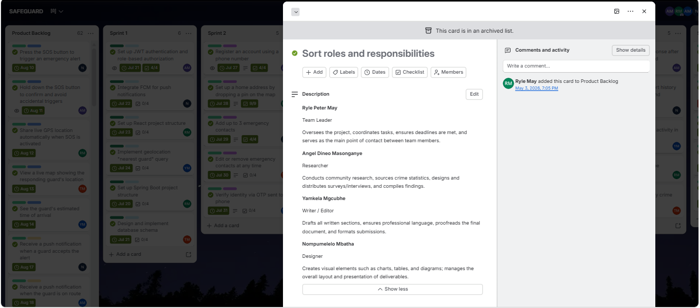
 
*Figure A1. The "Sort roles and responsibilities" card on our Trello board (the card now sits in an archived list, as the banner shows). Tebogo Makgato joined the team after this card was written.*
 

 

 
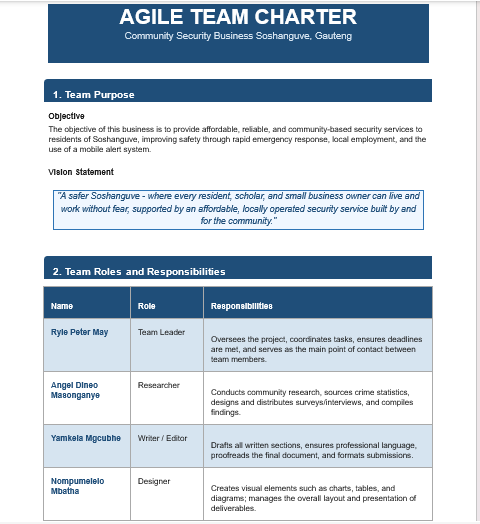
 
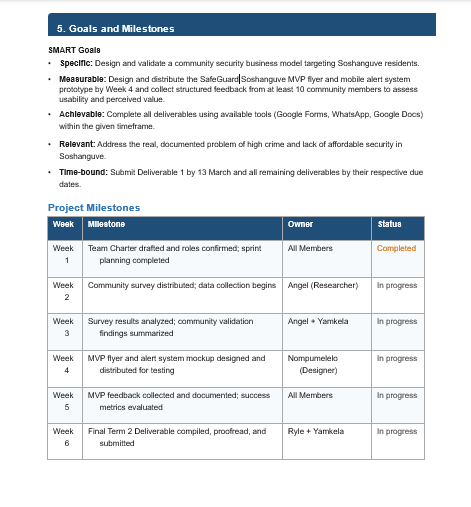
 
*Figure A2. The four pages of our Agile Team Charter.*
 
Every page of the charter is shown in Figure A2. Its main parts are also summarised below.
 
**Team purpose.** The objective of our business is to provide affordable, reliable, community-based security services to residents of Soshanguve, improving safety through rapid emergency response, local employment and a mobile alert system.
 
**Vision.** "A safer Soshanguve where every resident, scholar, and small business owner can live and work without fear, supported by an affordable, locally operated security service built by and for the community."
 
**Core values**
 
| Value | What it means for the team |
|---|---|
| Accountability | Every member takes ownership of their assigned tasks and meets agreed deadlines without needing to be reminded. |
| Collaboration | We work together and support one another rather than working in isolation. No one is left behind. |
| Respect | All opinions and ideas are heard and valued regardless of role or background. |
| Transparency | We are honest about our progress, challenges, and when we need help. No one hides problems from the group. |
| Commitment | We show up, contribute equally, and follow through on what we promise to the team. |
 
**Agile principles we committed to:** individuals and interactions over processes and tools; responding to change; continuous improvement; and delivering working results.
 
**Communication plan**
 
| Method | Purpose | Frequency |
|---|---|---|
| WhatsApp group | Daily check-ins, quick updates, file sharing | Daily |
| In-person meeting | Major decisions, task allocation, review of work | Once per week |
| MS Teams | Shared document editing and version control | Monday to Friday |
 
**Ground rules:** reply to WhatsApp messages within 24 hours; tell the team in advance if you cannot attend a meeting; decisions that affect the whole project are agreed by most of the team; nobody submits or changes shared work without informing the group.
 
**SMART goals**
 
- **Specific:** Design and validate a community security business model targeting Soshanguve residents.
- **Measurable:** Design and distribute the SafeGuard Soshanguve MVP flyer and mobile alert system prototype by Week 4 and collect structured feedback from at least 10 community members.
- **Achievable:** Complete all deliverables using available tools (Google Forms, WhatsApp, Google Docs) within the given timeframe.
- **Relevant:** Address the real, documented problem of high crime and lack of affordable security in Soshanguve.
- **Time-bound:** Submit Deliverable 1 by 13 March and all remaining deliverables by their due dates.
**Project milestones (status as recorded in the charter)**
 
| Week | Milestone | Owner | Status |
|---|---|---|---|
| 1 | Team charter drafted and roles confirmed; sprint planning completed | All members | Completed |
| 2 | Community survey distributed; data collection begins | Angel (Researcher) | In progress |
| 3 | Survey results analysed; community validation findings summarised | Angel and Yamkela | In progress |
| 4 | MVP flyer and alert system mockup designed and distributed for testing | Nompumelelo (Designer) | In progress |
| 5 | MVP feedback collected and documented; success metrics evaluated | All members | In progress |
| 6 | Final deliverable compiled, proofread and submitted | Ryle and Yamkela | In progress |
 
The charter was signed by the four original members: Ryle Peter May, Angel Dineo Masonganye, Yamkela Mgcubhe and Nompumelelo Mbatha.
 
#### Reflection
 
**Situation:** At the start of the project our team agreed on an Agile Team Charter that set out each person's role. The roles were recorded on Trello on 3 May 2026. The charter set a communication plan of a daily WhatsApp check-in, a weekly in-person meeting and MS Teams for shared documents. In practice we kept in touch mainly through our WhatsApp group, and Tebogo joined the team after the charter was written, so it lists four roles.
 
**Task:** My role on the charter was Researcher. This meant gathering and compiling information for the project, and I contributed through research and documents and, later, through work on the app.
 
**Action:** I used the charter as a reference for who was responsible for what, and the WhatsApp group for day-to-day communication. The charter was clear about roles and values, but it did not describe a specific step to take when a sprint fell behind or when a task was unclear. Those were two of the biggest problems I experienced.
 
**Result:** I learned that a charter only helps if the team keeps using it, and that good teamwork depends on clear communication. Next time I would add a short working agreement covering how to flag a task that is at risk early, what to do when a sprint falls behind, and how to bring a new member into the team.
 
 

### B. User Stories and Tasks
 
#### Evidence
 
Our features were written as user stories from the point of view of three types of user, shown as colour labels on the board: **Resident**, **Security** (guard) and **Admin**. Each story became a Trello card, and larger cards were broken into a checklist of tasks.
 
**Worked example 1: a story broken into tasks (9 tasks, 100% complete)**
 
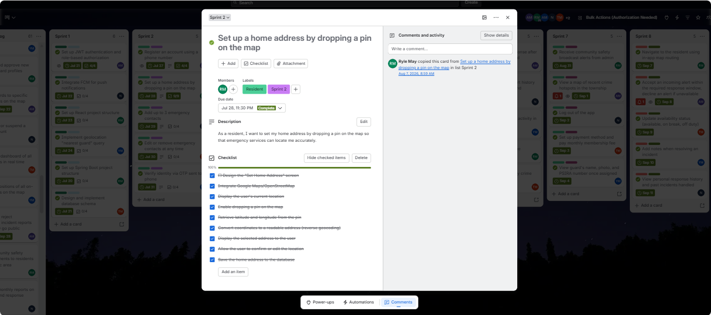
 
*Figure B1. Story card with its description, owner, label, due date and task checklist.*
 
Tasks on this card: Design the "Set Home Address" screen; Integrate Google Maps/OpenStreetMap; Display the user's current location; Enable dropping a pin on the map; Retrieve latitude and longitude from the pin; Convert coordinates to a readable address (reverse geocoding); Display the selected address to the user; Allow the user to confirm or edit the location; Save the home address to the database.
 
**Worked example 2: a smaller story (4 tasks, 100% complete)**
 
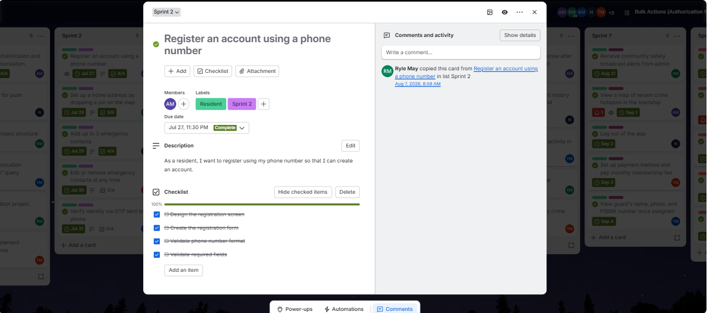
 
*Figure B2. Story card for phone-number registration with its four tasks.*
 
**Stories written in full "As a... I want... so that..." form on the board**
 
| Role | Story | Owner | Sprint |
|---|---|---|---|
| Resident | As a resident, I want to register using my phone number so that I can create an account. | Angel Dineo Masonganye | Sprint 2 |
| Resident | As a resident, I want to set my home address by dropping a pin on the map so that emergency services can locate me accurately. | Ryle May | Sprint 2 |
| Resident | As a resident, I want to add up to three emergency contacts so that they can be notified in case of an emergency. | Nompumelelo Mbatha | Sprint 2 |
| Resident | As a resident, I want to edit or remove my emergency contacts at any time so that my contact information remains up to date. | Tebogo Makgato | Sprint 2 |
| Resident | As a resident, I want to verify my identity via an OTP sent to my phone so that my account is secure. | Yamkela Mgcubhe | Sprint 2 |
| Security | As a security guard, I want to register my profile using my ID number and training certificate so that my account can be verified. | Nompumelelo Mbatha | Sprint 3 |
| Security | As a security guard, I want to log the end of my shift by checking out on the app so that my working hours are accurately recorded. | Tebogo Makgato | Sprint 3 |
 

<b>All user-story cards by sprint (click to expand)</b>

| Role | Story (card title) | Owner | Sprint | Due | Tasks listed | Status |
|---|---|---|---|---|---|---|
| Resident | Register an account using a phone number | Angel Dineo Masonganye | 2 | 27 Jul 2026 | 4 tasks | Done |
| Resident | Set up a home address by dropping a pin on the map | Ryle May | 2 | 28 Jul 2026 | 9 tasks | Done |
| Resident | Add up to 3 emergency contacts | Nompumelelo Mbatha | 2 | 29 Jul 2026 | 4 tasks | Done |
| Resident | Edit or remove emergency contacts at any time | Tebogo Makgato | 2 | 30 Jul 2026 | 4 tasks | Done |
| Resident | Verify identity via OTP sent to phone | Yamkela Mgcubhe | 2 | 31 Jul 2026 | 4 tasks | Done |
| Security | Register a guard profile with ID number and training certificate | Nompumelelo Mbatha | 3 | 3 Aug 2026 | 4 tasks | Done |
| Security | Log shift start by checking in on the app | Angel Dineo Masonganye | 3 | 4 Aug 2026 | 4 tasks | Done |
| Security | Log shift end by checking out on the app | Tebogo Makgato | 3 | 5 Aug 2026 | 4 tasks | Done |
| Security | View assigned patrol zone on the map | Ryle May | 3 | 6 Aug 2026 | - | Done |
| Security | Receive an emergency alert notification with resident name and location | Yamkela Mgcubhe | 3 | 7 Aug 2026 | - | Done |
| Resident | Press the SOS button to trigger an emergency alert | Nompumelelo Mbatha | 4 | 10 Aug 2026 | - | Done |
| Resident | Hold down the SOS button to confirm and avoid accidental triggers | Angel Dineo Masonganye | 4 | 11 Aug 2026 | - | Done |
| Resident | Share live GPS location automatically when SOS is activated | Ryle May | 4 | 12 Aug 2026 | - | Done |
| Resident | View a live map showing the responding guard's location | Tebogo Makgato | 4 | 13 Aug 2026 | - | Done |
| Resident | See the guard's estimated time of arrival | Yamkela Mgcubhe | 4 | 14 Aug 2026 | - | Done |
| Resident | Receive a push notification when a guard accepts the alert | Nompumelelo Mbatha | 5 | 17 Aug 2026 | - | Done |
| Resident | Receive a push notification when the guard is on route | Angel Dineo Masonganye | 5 | 18 Aug 2026 | - | Done |
| Resident | Receive a push notification when the guard has arrived | Tebogo Makgato | 5 | 19 Aug 2026 | - | Done |
| Resident | Cancel a false alarm before the guard departs | Yamkela Mgcubhe | 5 | 20 Aug 2026 | - | Done |
| Resident | View the full details of a resolved incident | Ryle May | 5 | 21 Aug 2026 | - | Done |
| Resident | Rate the guard's response after an incident is resolved | Angel Dineo Masonganye | 6 | 24 Aug 2026 | - | Done |
| Resident | View full personal alert history with dates, guards, and outcomes | Nompumelelo Mbatha | 6 | 25 Aug 2026 | - | Done |
| Resident | Report on suspicious activity in the area | Yamkela Mgcubhe | 6 | 26 Aug 2026 | - | Done |
| Resident | Select an incident type | Ryle May | 6 | 27 Aug 2026 | - | Done |
| Resident | View a live community crime feed filtered by area | Tebogo Makgato | 6 | 28 Aug 2026 | - | Done |
| Resident | Receive community safety broadcast alerts from admin | Ryle May | 7 | 31 Aug 2026 | - | Done |
| Resident | View a map of recent crime hotspots in the township | Angel Dineo Masonganye | 7 | 1 Sep 2026 | - | Done |
| Resident | Log out of the app | Nompumelelo Mbatha | 7 | 2 Sep 2026 | - | Done |
| Resident | Set up payment method and pay monthly membership fee | Tebogo Makgato | 7 | 3 Sep 2026 | - | Done |
| Resident | View guard's name, photo, and PSIRA number once assigned | Yamkela Mgcubhe | 7 | 4 Sep 2026 | - | Done |
| Security | Navigate to the resident using in-app map routing | Ryle May | 8 | 7 Sep 2026 | - | Done |
| Security | Accept an incoming alert within the required response window, decline an alert if unavailable | Angel Dineo Masonganye | 8 | 8 Sep 2026 | - | Done |
| Security | Update availability status (available, on break, off duty) | Tebogo Makgato | 8 | 9 Sep 2026 | - | Done |
| Security | Add notes when resolving an incident | Yamkela Mgcubhe | 8 | 10 Sep 2026 | - | Done |
| Security | View personal response history and past incidents handled | Nompumelelo Mbatha | 8 | 11 Sep 2026 | - | Done |
| Security | Upload PSIRA certificate and ID for verification during registration | Ryle May | 9 | 14 Sep 2026 | - | Done |
| Security | Receive notification when profile is approved/rejected by admin | Angel Dineo Masonganye | 9 | 15 Sep 2026 | - | Done |
| Security | View equipment checklist / confirm equipment issued | Nompumelelo Mbatha | 9 | 16 Sep 2026 | - | Done |
| Security | Report an equipment issue or request replacement | Tebogo Makgato | 9 | 17 Sep 2026 | - | Done |
| Security | Flag a safety concern about a specific alert (e.g. "needs backup") | Yamkela Mgcubhe | 9 | 18 Sep 2026 | - | Done |
| Admin | Register and approve new security guard profiles | Ryle May | 10 | 21 Sep 2026 | - | Done |
| Admin | Assign guards to specific patrol zones on the map | Angel Dineo Masonganye | 10 | 22 Sep 2026 | - | Done |
| Admin | Deactivate or suspend a guard account | Nompumelelo Mbatha | 10 | 23 Sep 2026 | - | Done |
| Admin | View a live dashboard of all active alerts in real time | Tebogo Makgato | 10 | 24 Sep 2026 | - | Done |
| Admin | View live positions of all on-duty guards on the map | Yamkela Mgcubhe | 10 | 25 Sep 2026 | - | Done |
| Admin | Approve or reject community incident reports before they go public | Angel Dineo Masonganye | 11 | 28 Sep 2026 | - | Done |
| Admin | Post community safety announcements to residents in a specific area | Ryle May | 11 | 29 Sep 2026 | - | Done |
| Admin | Generate monthly reports on incidents and response times | Nompumelelo Mbatha | 11 | 30 Sep 2026 | - | Done |
| Admin | View guard performance metrics and average response times | Yamkela Mgcubhe | 11 | 1 Oct 2026 | - | Done |
| Admin | Configure patrol zone boundaries on the map | Tebogo Makgato | 11 | 2 Oct 2026 | - | Done |
| Admin | Manage membership payments | Ryle May | 12 | 5 Oct 2026 | - | Done |
| Admin | Handle refunds or fee disputes | Angel Dineo Masonganye | 12 | 6 Oct 2026 | - | Done |
| Admin | Manage guard equipment inventory | Nompumelelo Mbatha | 12 | 7 Oct 2026 | - | Done |
| Admin | Broadcast emergency-wide alert (not area-specific) | Tebogo Makgato | 12 | 8 Oct 2026 | - | Done |
| Admin | Review and resolve guard safety flags | Yamkela Mgcubhe | 12 | 9 Oct 2026 | - | Done |
 

#### Reflection
 
**Situation:** Our features on Trello are written as user stories for three kinds of user: residents, security guards and admins. Each story is a card, and bigger stories have a checklist of tasks.
 
**Task:** I worked on research and documents and, from August, on features of the app, so my job was to understand what these users needed and support the team with that information.
 
**Action:** I found that the cards were not all equally clear. A card such as "Set up a home address by dropping a pin on the map" has a full "As a resident, I want..." sentence and nine tasks, from designing the screen to saving the address. Many other cards only have a title. When a card had only a title, it was harder to tell exactly what was needed, and unclear stories and tasks were one of my main challenges.
 
**Result:** I learned that the story format keeps the focus on the user and the reason for a feature, and that splitting a story into tasks makes the work measurable. If I did this again, I would write the full story and its acceptance criteria on every card before the sprint starts.
 
 

### C. Product Backlog
 
#### Evidence
 
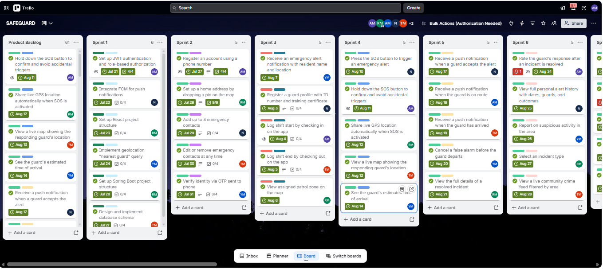
 
*Figure C1. The Product Backlog list (left) alongside Sprints 1 to 6. Cards carry a role/category label, a sprint label and a due date.*
 
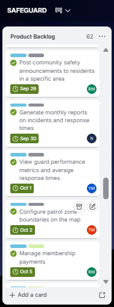
 
*Figure C2. A middle section of the Product Backlog list.*
 
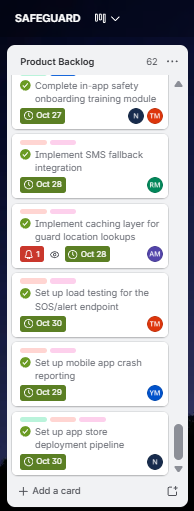
 
*Figure C3. The bottom of the Product Backlog list.*
 
The backlog on our board held **61 items** when I exported it (the live board now shows 62). Items are grouped by category label:
 
| Category | Items |
|---|---|
| Resident | 19 |
| Admin | 15 |
| Security | 10 |
| Integration | 5 |
| Dev Wrap-Up | 5 |
| Deployment | 4 |
| Onboarding | 2 |
| Deployment, Onboarding | 1 |
 
The board has **no separate priority field**. Priority was expressed by the **sprint each item was assigned to** (the "Sprint N" label) and its due date. No bug-fix items were recorded on the board.
 

<b>Full product backlog (click to expand)</b>

| # | Backlog item | Category | Planned sprint | Due | Status |
|---|---|---|---|---|---|
| 1 | Hold down the SOS button to confirm and avoid accidental triggers | Resident | Sprint 4 | 11 Aug 2026 | Done |
| 2 | Share live GPS location automatically when SOS is activated | Resident | Sprint 4 | 12 Aug 2026 | Done |
| 3 | View a live map showing the responding guard's location | Resident | Sprint 4 | 13 Aug 2026 | Done |
| 4 | See the guard's estimated time of arrival | Resident | Sprint 4 | 14 Aug 2026 | Done |
| 5 | Receive a push notification when a guard accepts the alert | Resident | Sprint 5 | 17 Aug 2026 | Done |
| 6 | Receive a push notification when the guard is on route | Resident | Sprint 5 | 18 Aug 2026 | Done |
| 7 | Receive a push notification when the guard has arrived | Resident | Sprint 5 | 19 Aug 2026 | Done |
| 8 | Cancel a false alarm before the guard departs | Resident | Sprint 5 | 20 Aug 2026 | Done |
| 9 | View the full details of a resolved incident | Resident | Sprint 5 | 21 Aug 2026 | Done |
| 10 | Rate the guard's response after an incident is resolved | Resident | Sprint 6 | 24 Aug 2026 | Done |
| 11 | View full personal alert history with dates, guards, and outcomes | Resident | Sprint 6 | 25 Aug 2026 | Done |
| 12 | Report on suspicious activity in the area | Resident | Sprint 6 | 26 Aug 2026 | Done |
| 13 | Select an incident type | Resident | Sprint 6 | 27 Aug 2026 | Done |
| 14 | View a live community crime feed filtered by area | Resident | Sprint 6 | 28 Aug 2026 | Done |
| 15 | Receive community safety broadcast alerts from admin | Resident | Sprint 7 | 31 Aug 2026 | Done |
| 16 | View a map of recent crime hotspots in the township | Resident | Sprint 7 | 1 Sep 2026 | Done |
| 17 | Log out of the app | Resident | Sprint 7 | 2 Sep 2026 | Done |
| 18 | Set up payment method and pay monthly membership fee | Resident | Sprint 7 | 3 Sep 2026 | Done |
| 19 | View guard's name, photo, and PSIRA number once assigned | Resident | Sprint 7 | 4 Sep 2026 | Done |
| 20 | Navigate to the resident using in-app map routing | Security | Sprint 8 | 7 Sep 2026 | Done |
| 21 | Accept an incoming alert within the required response window, decline an alert if unavailable | Security | Sprint 8 | 8 Sep 2026 | Done |
| 22 | Update availability status (available, on break, off duty) | Security | Sprint 8 | 9 Sep 2026 | Done |
| 23 | Add notes when resolving an incident | Security | Sprint 8 | 10 Sep 2026 | Done |
| 24 | View personal response history and past incidents handled | Security | Sprint 8 | 11 Sep 2026 | Done |
| 25 | Upload PSIRA certificate and ID for verification during registration | Security | Sprint 9 | 14 Sep 2026 | Done |
| 26 | Receive notification when profile is approved/rejected by admin | Security | Sprint 9 | 15 Sep 2026 | Done |
| 27 | View equipment checklist / confirm equipment issued | Security | Sprint 9 | 16 Sep 2026 | Done |
| 28 | Report an equipment issue or request replacement | Security | Sprint 9 | 17 Sep 2026 | Done |
| 29 | Flag a safety concern about a specific alert (e.g. "needs backup") | Security | Sprint 9 | 18 Sep 2026 | Done |
| 30 | Register and approve new security guard profiles | Admin | Sprint 10 | 21 Sep 2026 | Done |
| 31 | Assign guards to specific patrol zones on the map | Admin | Sprint 10 | 22 Sep 2026 | Done |
| 32 | Deactivate or suspend a guard account | Admin | Sprint 10 | 23 Sep 2026 | Done |
| 33 | View a live dashboard of all active alerts in real time | Admin | Sprint 10 | 24 Sep 2026 | Done |
| 34 | View live positions of all on-duty guards on the map | Admin | Sprint 10 | 25 Sep 2026 | Done |
| 35 | Approve or reject community incident reports before they go public | Admin | Sprint 11 | 28 Sep 2026 | Done |
| 36 | Post community safety announcements to residents in a specific area | Admin | Sprint 11 | 29 Sep 2026 | Done |
| 37 | Generate monthly reports on incidents and response times | Admin | Sprint 11 | 30 Sep 2026 | Done |
| 38 | View guard performance metrics and average response times | Admin | Sprint 11 | 1 Oct 2026 | Done |
| 39 | Configure patrol zone boundaries on the map | Admin | Sprint 11 | 2 Oct 2026 | Done |
| 40 | Manage membership payments | Admin | Sprint 12 | 5 Oct 2026 | Done |
| 41 | Handle refunds or fee disputes | Admin | Sprint 12 | 6 Oct 2026 | Done |
| 42 | Manage guard equipment inventory | Admin | Sprint 12 | 7 Oct 2026 | Done |
| 43 | Broadcast emergency-wide alert (not area-specific) | Admin | Sprint 12 | 8 Oct 2026 | Done |
| 44 | Review and resolve guard safety flags | Admin | Sprint 12 | 9 Oct 2026 | Done |
| 45 | Integrate payment gateway sandbox and webhook handling | Integration | Sprint 13 | 12 Oct 2026 | Done |
| 46 | Set up WebSocket channel for live alert status updates | Integration | Sprint 13 | 13 Oct 2026 | Done |
| 47 | Implement API rate limiting / abuse protection on SOS endpoint | Integration | Sprint 13 | 14 Oct 2026 | Done |
| 48 | Write API documentation | Integration | Sprint 13 | 15 Oct 2026 | Done |
| 49 | Set up error logging/monitoring | Integration | Sprint 13 | 16 Oct 2026 | Done |
| 50 | Write unit tests | Dev Wrap-Up | Sprint 14 | 19 Oct 2026 | Done |
| 51 | Set up staging environment and deployment pipeline | Dev Wrap-Up | Sprint 14 | 20 Oct 2026 | Done |
| 52 | POPIA compliance review | Dev Wrap-Up | Sprint 14 | 21 Oct 2026 | Done |
| 53 | Conduct security penetration testing before launch | Dev Wrap-Up | Sprint 14 | 22 Oct 2026 | Done |
| 54 | Set up automated database backup and recovery plan | Dev Wrap-Up | Sprint 14 | 23 Oct 2026 | Done |
| 55 | Complete first-time app onboarding walkthrough | Onboarding | Sprint 15 | 26 Oct 2026 | Done |
| 56 | Complete in-app safety onboarding training module | Onboarding | Sprint 15 | 27 Oct 2026 | Done |
| 57 | Implement SMS fallback integration | Deployment | Sprint 16 | 28 Oct 2026 | Done |
| 58 | Implement caching layer for guard location lookups | Deployment | Sprint 16 | 28 Oct 2026 | Done |
| 59 | Set up mobile app crash reporting | Deployment | Sprint 16 | 29 Oct 2026 | Done |
| 60 | Set up load testing for the SOS/alert endpoint | Deployment | Sprint 16 | 30 Oct 2026 | Done |
| 61 | Set up app store deployment pipeline | Deployment, Onboarding | Sprint 16 | 30 Oct 2026 | Done |
 

#### Reflection
 
**Situation:** Our product backlog on Trello holds about 60 items. They are grouped by user type (Resident, Security, Admin) and by technical areas such as infrastructure, integration and deployment.
 
**Task:** I needed to understand what the backlog contained and where the work I was supporting fitted in.
 
**Action:** The board has no priority field, so I used each card's sprint label and due date to see what was planned first. In early August we revised the backlog after lecturer feedback, and my logbook records this from 4 to 7 August. The backlog also kept developing as the project went on: items such as an SMS fallback, caching and load testing appear in the final sprint, which suggests the requirements were still changing.
 
**Result:** The backlog gave the team one place to see every requirement, and it made a large project feel manageable. I learned that a backlog needs more than a list: it needs clear priorities and some estimate of effort. Next time I would give every item a priority such as Must, Should or Could, and keep a place for bug fixes.
 
 

### D. Sprint Backlog
 
#### Evidence
 
We planned **16 sprints**, each a list on the Trello board holding 2 to 6 cards, with an owner and a due date on every card.
 

 
*Figure D1. Sprints 1 to 6 with owners, due dates and completion ticks.*
 
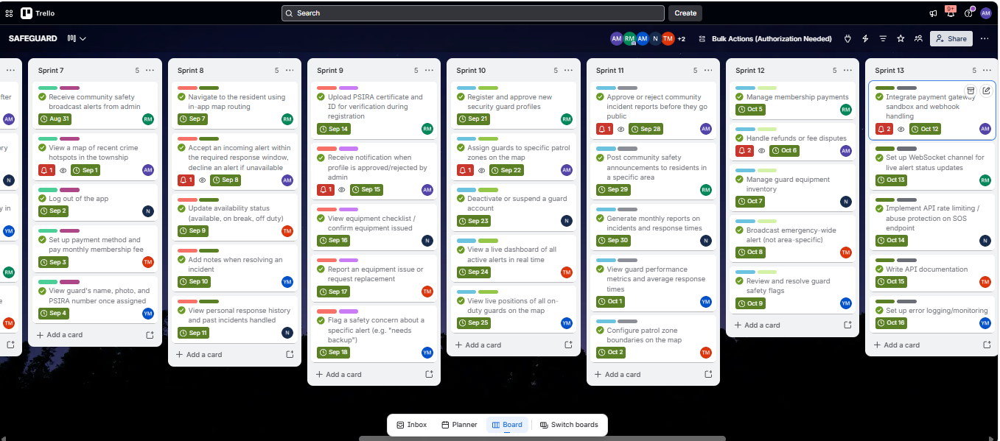
 
*Figure D2. Sprints 7 to 13, all cards marked complete.*
 
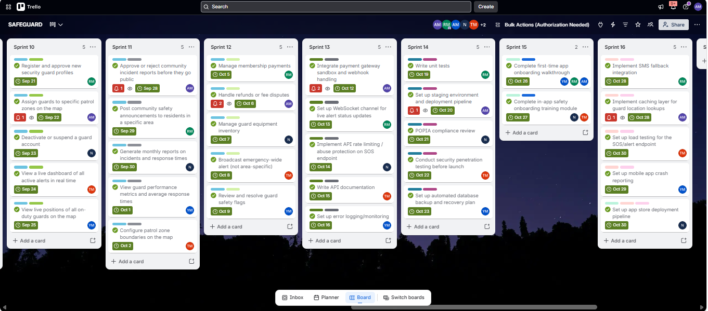
 
*Figure D3. Sprints 10 to 16, all cards marked complete.*
 
| Sprint | Planned dates | Focus | Items | Team members | Status |
|---|---|---|---|---|---|
| 1 | 20 Jul 2026 to 24 Jul 2026 | Infrastructure | 6 | Ryle May, Angel Dineo Masonganye, Tebogo Makgato, Nompumelelo Mbatha, Yamkela Mgcubhe | Done |
| 2 | 27 Jul 2026 to 31 Jul 2026 | Resident | 5 | Angel Dineo Masonganye, Ryle May, Nompumelelo Mbatha, Tebogo Makgato, Yamkela Mgcubhe | Done |
| 3 | 3 Aug 2026 to 7 Aug 2026 | Security | 5 | Nompumelelo Mbatha, Angel Dineo Masonganye, Tebogo Makgato, Ryle May, Yamkela Mgcubhe | Done |
| 4 | 10 Aug 2026 to 14 Aug 2026 | Resident | 5 | Nompumelelo Mbatha, Angel Dineo Masonganye, Ryle May, Tebogo Makgato, Yamkela Mgcubhe | Done |
| 5 | 17 Aug 2026 to 21 Aug 2026 | Resident | 5 | Nompumelelo Mbatha, Angel Dineo Masonganye, Tebogo Makgato, Yamkela Mgcubhe, Ryle May | Done |
| 6 | 24 Aug 2026 to 28 Aug 2026 | Resident | 5 | Angel Dineo Masonganye, Nompumelelo Mbatha, Yamkela Mgcubhe, Ryle May, Tebogo Makgato | Done |
| 7 | 31 Aug 2026 to 4 Sep 2026 | Resident | 5 | Ryle May, Angel Dineo Masonganye, Nompumelelo Mbatha, Tebogo Makgato, Yamkela Mgcubhe | Done |
| 8 | 7 Sep 2026 to 11 Sep 2026 | Security | 5 | Ryle May, Angel Dineo Masonganye, Tebogo Makgato, Yamkela Mgcubhe, Nompumelelo Mbatha | Done |
| 9 | 14 Sep 2026 to 18 Sep 2026 | Security | 5 | Ryle May, Angel Dineo Masonganye, Nompumelelo Mbatha, Tebogo Makgato, Yamkela Mgcubhe | Done |
| 10 | 21 Sep 2026 to 25 Sep 2026 | Admin | 5 | Ryle May, Angel Dineo Masonganye, Nompumelelo Mbatha, Tebogo Makgato, Yamkela Mgcubhe | Done |
| 11 | 28 Sep 2026 to 2 Oct 2026 | Admin | 5 | Angel Dineo Masonganye, Ryle May, Nompumelelo Mbatha, Yamkela Mgcubhe, Tebogo Makgato | Done |
| 12 | 5 Oct 2026 to 9 Oct 2026 | Admin | 5 | Ryle May, Angel Dineo Masonganye, Nompumelelo Mbatha, Tebogo Makgato, Yamkela Mgcubhe | Done |
| 13 | 12 Oct 2026 to 16 Oct 2026 | Integration | 5 | Angel Dineo Masonganye, Ryle May, Nompumelelo Mbatha, Tebogo Makgato, Yamkela Mgcubhe | Done |
| 14 | 19 Oct 2026 to 23 Oct 2026 | Dev Wrap-Up | 5 | Ryle May, Angel Dineo Masonganye, Nompumelelo Mbatha, Tebogo Makgato, Yamkela Mgcubhe | Done |
| 15 | 26 Oct 2026 to 27 Oct 2026 | Onboarding | 2 | Yamkela Mgcubhe, Ryle May, Angel Dineo Masonganye, Nompumelelo Mbatha, Tebogo Makgato | Done |
| 16 | 28 Oct 2026 to 30 Oct 2026 | Deployment, Onboarding | 5 | Ryle May, Angel Dineo Masonganye, Yamkela Mgcubhe, Tebogo Makgato, Nompumelelo Mbatha | Done |
 
**Sprint aims.** Formal sprint goals were not recorded on Trello, so the aims below are summarised from the cards in each sprint.
 
| Sprint | Aim (summarised from its cards) |
|---|---|
| 2 | Let a resident create a verified account and set up a home address and emergency contacts. |
| 4 | Let a resident trigger an SOS alert and see the responding guard's location and arrival time. |
| 13 | Integrate payments and real-time updates, and make the backend secure, documented and monitored. |
 

<b>Items, tasks and owners for every sprint (click to expand)</b>

**Sprint 1**
 
| Item | Owner | Due | Tasks | Status |
|---|---|---|---|---|
| Set up Spring Boot project structure | Ryle May | 20 Jul 2026 | 4 tasks | Done |
| Set up JWT authentication and role-based authorization | Angel Dineo Masonganye | 21 Jul 2026 | 4 tasks | Done |
| Design and implement database schema | Tebogo Makgato | 21 Jul 2026 | 4 tasks | Done |
| Integrate FCM for push notifications | Nompumelelo Mbatha | 22 Jul 2026 | 4 tasks | Done |
| Set up React project structure | Ryle May | 23 Jul 2026 | 4 tasks | Done |
| Implement geolocation "nearest guard" query | Yamkela Mgcubhe | 24 Jul 2026 | 4 tasks | Done |
 
**Sprint 2**
 
| Item | Owner | Due | Tasks | Status |
|---|---|---|---|---|
| Register an account using a phone number | Angel Dineo Masonganye | 27 Jul 2026 | 4 tasks | Done |
| Set up a home address by dropping a pin on the map | Ryle May | 28 Jul 2026 | 9 tasks | Done |
| Add up to 3 emergency contacts | Nompumelelo Mbatha | 29 Jul 2026 | 4 tasks | Done |
| Edit or remove emergency contacts at any time | Tebogo Makgato | 30 Jul 2026 | 4 tasks | Done |
| Verify identity via OTP sent to phone | Yamkela Mgcubhe | 31 Jul 2026 | 4 tasks | Done |
 
**Sprint 3**
 
| Item | Owner | Due | Tasks | Status |
|---|---|---|---|---|
| Register a guard profile with ID number and training certificate | Nompumelelo Mbatha | 3 Aug 2026 | 4 tasks | Done |
| Log shift start by checking in on the app | Angel Dineo Masonganye | 4 Aug 2026 | 4 tasks | Done |
| Log shift end by checking out on the app | Tebogo Makgato | 5 Aug 2026 | 4 tasks | Done |
| View assigned patrol zone on the map | Ryle May | 6 Aug 2026 | - | Done |
| Receive an emergency alert notification with resident name and location | Yamkela Mgcubhe | 7 Aug 2026 | - | Done |
 
**Sprint 4**
 
| Item | Owner | Due | Tasks | Status |
|---|---|---|---|---|
| Press the SOS button to trigger an emergency alert | Nompumelelo Mbatha | 10 Aug 2026 | - | Done |
| Hold down the SOS button to confirm and avoid accidental triggers | Angel Dineo Masonganye | 11 Aug 2026 | - | Done |
| Share live GPS location automatically when SOS is activated | Ryle May | 12 Aug 2026 | - | Done |
| View a live map showing the responding guard's location | Tebogo Makgato | 13 Aug 2026 | - | Done |
| See the guard's estimated time of arrival | Yamkela Mgcubhe | 14 Aug 2026 | - | Done |
 
**Sprint 5**
 
| Item | Owner | Due | Tasks | Status |
|---|---|---|---|---|
| Receive a push notification when a guard accepts the alert | Nompumelelo Mbatha | 17 Aug 2026 | - | Done |
| Receive a push notification when the guard is on route | Angel Dineo Masonganye | 18 Aug 2026 | - | Done |
| Receive a push notification when the guard has arrived | Tebogo Makgato | 19 Aug 2026 | - | Done |
| Cancel a false alarm before the guard departs | Yamkela Mgcubhe | 20 Aug 2026 | - | Done |
| View the full details of a resolved incident | Ryle May | 21 Aug 2026 | - | Done |
 
**Sprint 6**
 
| Item | Owner | Due | Tasks | Status |
|---|---|---|---|---|
| Rate the guard's response after an incident is resolved | Angel Dineo Masonganye | 24 Aug 2026 | - | Done |
| View full personal alert history with dates, guards, and outcomes | Nompumelelo Mbatha | 25 Aug 2026 | - | Done |
| Report on suspicious activity in the area | Yamkela Mgcubhe | 26 Aug 2026 | - | Done |
| Select an incident type | Ryle May | 27 Aug 2026 | - | Done |
| View a live community crime feed filtered by area | Tebogo Makgato | 28 Aug 2026 | - | Done |
 
**Sprint 7**
 
| Item | Owner | Due | Tasks | Status |
|---|---|---|---|---|
| Receive community safety broadcast alerts from admin | Ryle May | 31 Aug 2026 | - | Done |
| View a map of recent crime hotspots in the township | Angel Dineo Masonganye | 1 Sep 2026 | - | Done |
| Log out of the app | Nompumelelo Mbatha | 2 Sep 2026 | - | Done |
| Set up payment method and pay monthly membership fee | Tebogo Makgato | 3 Sep 2026 | - | Done |
| View guard's name, photo, and PSIRA number once assigned | Yamkela Mgcubhe | 4 Sep 2026 | - | Done |
 
**Sprint 8**
 
| Item | Owner | Due | Tasks | Status |
|---|---|---|---|---|
| Navigate to the resident using in-app map routing | Ryle May | 7 Sep 2026 | - | Done |
| Accept an incoming alert within the required response window, decline an alert if unavailable | Angel Dineo Masonganye | 8 Sep 2026 | - | Done |
| Update availability status (available, on break, off duty) | Tebogo Makgato | 9 Sep 2026 | - | Done |
| Add notes when resolving an incident | Yamkela Mgcubhe | 10 Sep 2026 | - | Done |
| View personal response history and past incidents handled | Nompumelelo Mbatha | 11 Sep 2026 | - | Done |
 
**Sprint 9**
 
| Item | Owner | Due | Tasks | Status |
|---|---|---|---|---|
| Upload PSIRA certificate and ID for verification during registration | Ryle May | 14 Sep 2026 | - | Done |
| Receive notification when profile is approved/rejected by admin | Angel Dineo Masonganye | 15 Sep 2026 | - | Done |
| View equipment checklist / confirm equipment issued | Nompumelelo Mbatha | 16 Sep 2026 | - | Done |
| Report an equipment issue or request replacement | Tebogo Makgato | 17 Sep 2026 | - | Done |
| Flag a safety concern about a specific alert (e.g. "needs backup") | Yamkela Mgcubhe | 18 Sep 2026 | - | Done |
 
**Sprint 10**
 
| Item | Owner | Due | Tasks | Status |
|---|---|---|---|---|
| Register and approve new security guard profiles | Ryle May | 21 Sep 2026 | - | Done |
| Assign guards to specific patrol zones on the map | Angel Dineo Masonganye | 22 Sep 2026 | - | Done |
| Deactivate or suspend a guard account | Nompumelelo Mbatha | 23 Sep 2026 | - | Done |
| View a live dashboard of all active alerts in real time | Tebogo Makgato | 24 Sep 2026 | - | Done |
| View live positions of all on-duty guards on the map | Yamkela Mgcubhe | 25 Sep 2026 | - | Done |
 
**Sprint 11**
 
| Item | Owner | Due | Tasks | Status |
|---|---|---|---|---|
| Approve or reject community incident reports before they go public | Angel Dineo Masonganye | 28 Sep 2026 | - | Done |
| Post community safety announcements to residents in a specific area | Ryle May | 29 Sep 2026 | - | Done |
| Generate monthly reports on incidents and response times | Nompumelelo Mbatha | 30 Sep 2026 | - | Done |
| View guard performance metrics and average response times | Yamkela Mgcubhe | 1 Oct 2026 | - | Done |
| Configure patrol zone boundaries on the map | Tebogo Makgato | 2 Oct 2026 | - | Done |
 
**Sprint 12**
 
| Item | Owner | Due | Tasks | Status |
|---|---|---|---|---|
| Manage membership payments | Ryle May | 5 Oct 2026 | - | Done |
| Handle refunds or fee disputes | Angel Dineo Masonganye | 6 Oct 2026 | - | Done |
| Manage guard equipment inventory | Nompumelelo Mbatha | 7 Oct 2026 | - | Done |
| Broadcast emergency-wide alert (not area-specific) | Tebogo Makgato | 8 Oct 2026 | - | Done |
| Review and resolve guard safety flags | Yamkela Mgcubhe | 9 Oct 2026 | - | Done |
 
**Sprint 13**
 
| Item | Owner | Due | Tasks | Status |
|---|---|---|---|---|
| Integrate payment gateway sandbox and webhook handling | Angel Dineo Masonganye | 12 Oct 2026 | - | Done |
| Set up WebSocket channel for live alert status updates | Ryle May | 13 Oct 2026 | - | Done |
| Implement API rate limiting / abuse protection on SOS endpoint | Nompumelelo Mbatha | 14 Oct 2026 | - | Done |
| Write API documentation | Tebogo Makgato | 15 Oct 2026 | - | Done |
| Set up error logging/monitoring | Yamkela Mgcubhe | 16 Oct 2026 | - | Done |
 
**Sprint 14**
 
| Item | Owner | Due | Tasks | Status |
|---|---|---|---|---|
| Write unit tests | Ryle May | 19 Oct 2026 | - | Done |
| Set up staging environment and deployment pipeline | Angel Dineo Masonganye | 20 Oct 2026 | - | Done |
| POPIA compliance review | Nompumelelo Mbatha | 21 Oct 2026 | - | Done |
| Conduct security penetration testing before launch | Tebogo Makgato | 22 Oct 2026 | - | Done |
| Set up automated database backup and recovery plan | Yamkela Mgcubhe | 23 Oct 2026 | - | Done |
 
**Sprint 15**
 
| Item | Owner | Due | Tasks | Status |
|---|---|---|---|---|
| Complete first-time app onboarding walkthrough | Yamkela Mgcubhe, Ryle May, Angel Dineo Masonganye | 26 Oct 2026 | - | Done |
| Complete in-app safety onboarding training module | Nompumelelo Mbatha, Tebogo Makgato | 27 Oct 2026 | - | Done |
 
**Sprint 16**
 
| Item | Owner | Due | Tasks | Status |
|---|---|---|---|---|
| Implement SMS fallback integration | Ryle May | 28 Oct 2026 | - | Done |
| Implement caching layer for guard location lookups | Angel Dineo Masonganye | 28 Oct 2026 | - | Done |
| Set up mobile app crash reporting | Yamkela Mgcubhe | 29 Oct 2026 | - | Done |
| Set up load testing for the SOS/alert endpoint | Tebogo Makgato | 30 Oct 2026 | - | Done |
| Set up app store deployment pipeline | Nompumelelo Mbatha | 30 Oct 2026 | - | Done |
 

#### Reflection
 
**Situation:** We planned 16 weekly sprints, from 20 July to 30 October 2026. Every sprint card has an owner and a due date. The sprint lists were all created in one planning session on 7 August, so the full plan was laid out in advance.
 
**Task:** My task was to keep up with the due dates on the cards assigned to me while also meeting the demands of my other modules.
 
**Action:** Keeping up with sprint due dates while balancing other modules was my biggest challenge. My logbook for 4 August also records that not being familiar with the programming languages slowed me down when I started coding. Seeing a whole week's cards together in one list helped me see what was due next, but it did not remove the pressure when several modules had deadlines at the same time.
 
**Result:** I learned that sprint planning has to take real workload into account, not only the list of features. Our board also does not state a sprint goal, which makes it harder to judge whether a sprint achieved its purpose and not just whether its cards were ticked. Next time I would write a one-line goal for each sprint and hold a short review at the end of it.
 
 

### E. Agile Logbook
 
#### Evidence
 
Entries marked **Logbook** come from my own Agile logbook (taskboard, walkthrough and daily standup entries). Entries marked **Trello record** come from the board's own activity history.
 
| Date | Activity | Progress or outcome | Challenges and learning |
|---|---|---|---|
| 3 May 2026 | **Trello record:** Ryle May added the "Sort roles and responsibilities" card to the Product Backlog. | Roles recorded for the four original members (Figure A1). | Writing the roles down early gave the team a shared starting point. |
| 24 Jul 2026 | **Trello record:** Team members were assigned to cards (24 assignments, 2 removals) by Ryle May. | Owners recorded on cards. | Giving every card an owner makes it clear who is responsible. |
| 4 Aug 2026 | **Logbook:** Evaluated the presentation and worked with the team to revise the Product Backlog. | Planned next: start coding the features of the app. | Impediment recorded: not being familiar with the programming languages. |
| 5 Aug 2026 | **Logbook:** Implemented the necessary Product Backlog revisions and updated the Trello board. | Planned next: present the revised backlog and collect feedback from the lecturer. | No significant issues recorded. |
| 6 Aug 2026 | **Logbook:** Showed the frontend to the lecturer and received suggestions for improvement. | Planned next: revise the Product Backlog and presentation using the feedback. | Several adjustments were required before the backlog could be approved. |
| 6 Aug 2026 | **Trello record:** Three trial board layouts were created in one evening ("In Progress", "Sprint Current", "Sprint / Current"); task checklists were added to 15 cards and 27 cards were moved between lists. | The board layout changed several times before the final sprint structure. | The structure was not right the first time, so it needed trying and adjusting. |
| 7 Aug 2026 | **Logbook:** Revised the Product Backlog, improved the app, and presented the updated version to the lecturer. | Planned next: review the approved backlog and organise future tasks for the next sprint. | No impediments recorded. |
| 7 Aug 2026 | **Trello record:** Lists "Sprint 1" to "Sprint 16" were created between about 08:55 and 09:02, and cards were copied into them. | Sprint structure set up for the whole project. | A full plan up front is useful, but a plan this long needs reviewing as work changes. |
| 20 to 21 Oct 2026 | **Trello record:** A large board update by Ryle May: about 35 backlog cards and about 45 cards in Sprints 4 to 12 were updated, 69 member assignments were made, and 66 cards were copied into a "Sprint / Completed" list. | Completed work was grouped together on the board. | Changing many cards at once is quick, but it records one date for many tasks. It is better to update the board as each task is finished. |
| 26 to 27 Oct 2026 | **Trello record:** Nompumelelo updated 11 cards on 26 Oct. On 27 Oct I ticked off the task checklists on "Register an account using a phone number" (4 items) and "Set up a home address..." (9 items). | Checklists on the worked examples (Figures B1 and B2) brought up to date. | Updating at the end shows when the board was updated, not when the work was done. In future I will tick tasks off as I finish them. |
| 28 Oct 2026 | **Board status (screenshots):** Sprint 13 to 16 cards shown as complete (Figure D2). | All 78 sprint cards shown as done. | A board with every card complete is a useful final record of the scope we delivered. |
 
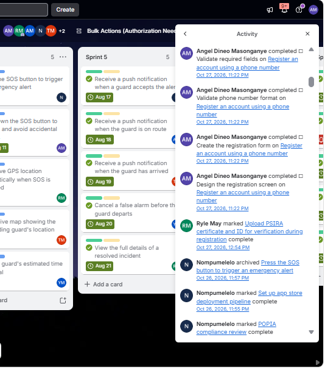
 
*Figure E1. The Trello activity history for our SAFEGUARD board.*
 
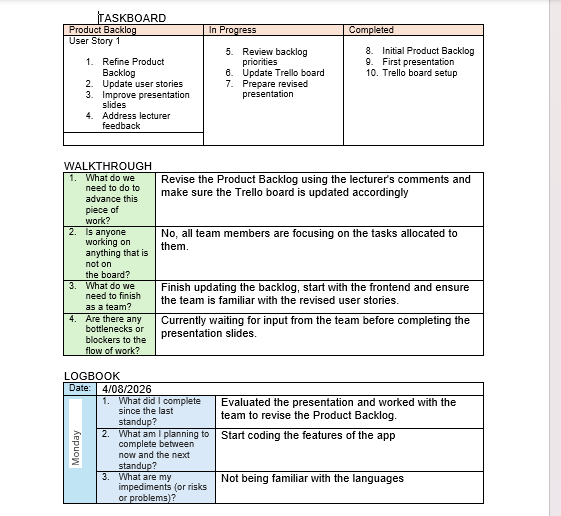
 
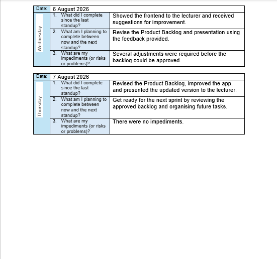
 
*Figure E2. My Agile logbook (taskboard, walkthrough and daily standup entries for 4 to 7 August 2026).*
 
**My assigned cards (from Trello):**
 
| Sprint | Card | Due |
|---|---|---|
| 1 | Set up JWT authentication and role-based authorization | 21 Jul 2026 |
| 2 | Register an account using a phone number | 27 Jul 2026 |
| 3 | Log shift start by checking in on the app | 4 Aug 2026 |
| 4 | Hold down the SOS button to confirm and avoid accidental triggers | 11 Aug 2026 |
| 5 | Receive a push notification when the guard is on route | 18 Aug 2026 |
| 6 | Rate the guard's response after an incident is resolved | 24 Aug 2026 |
| 7 | View a map of recent crime hotspots in the township | 1 Sep 2026 |
| 8 | Accept an incoming alert within the required response window, decline an alert if unavailable | 8 Sep 2026 |
| 9 | Receive notification when profile is approved/rejected by admin | 15 Sep 2026 |
| 10 | Assign guards to specific patrol zones on the map | 22 Sep 2026 |
| 11 | Approve or reject community incident reports before they go public | 28 Sep 2026 |
| 12 | Handle refunds or fee disputes | 6 Oct 2026 |
| 13 | Integrate payment gateway sandbox and webhook handling | 12 Oct 2026 |
| 14 | Set up staging environment and deployment pipeline | 20 Oct 2026 |
| 15 | Complete first-time app onboarding walkthrough | 26 Oct 2026 |
| 16 | Implement caching layer for guard location lookups | 28 Oct 2026 |
 
Trello lists me as the owner of these cards. My contribution combined research and documents with work on the app from August, when I was still learning some of the programming languages (logbook, 4 August 2026).
 
#### Reflection
 
**Situation:** I kept an Agile logbook using the course template (a taskboard, a walkthrough and daily standup entries) alongside our Trello board. My entries for 4 to 7 August 2026 record how we revised the Product Backlog after lecturer feedback. Much of our day-to-day communication happened in our WhatsApp group, which is not part of that formal record.
 
**Task:** I wanted the logbook to show our progress and accountability honestly.
 
**Action:** Each entry made me state what I had finished, what I planned next and what was blocking me. Comparing my entries with the Trello history, the same week shows the board being rebuilt (6 to 7 August) after the lecturer feedback. The history also shows that some checklists, including two of mine, were ticked on 27 October, so the board shows when it was updated, not always when the work was done.
 
**Result:** I learned that a logbook only supports progress tracking and accountability if it is kept as the work happens. A late entry is still honest, but it is weaker evidence. From now on I will record progress on the same day, add a short note on what went wrong and what I learned, and use that to improve the next sprint.
 
 
